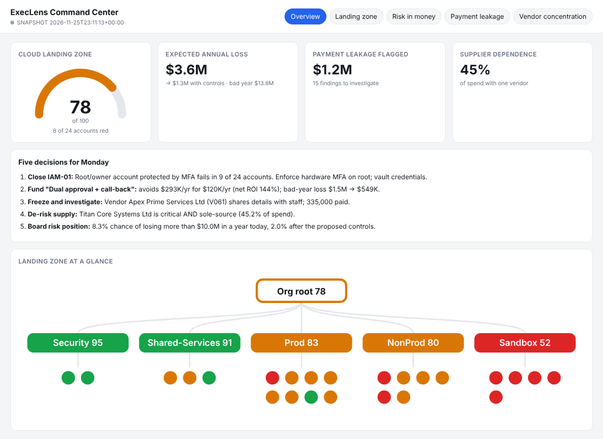
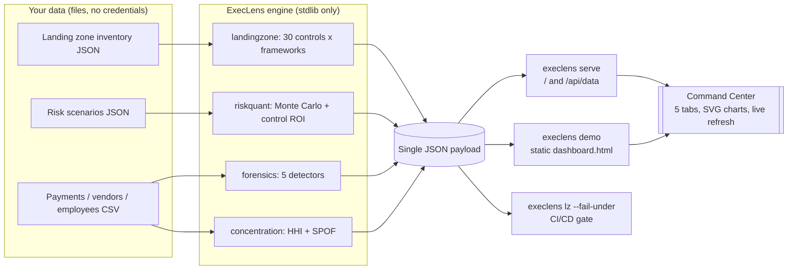
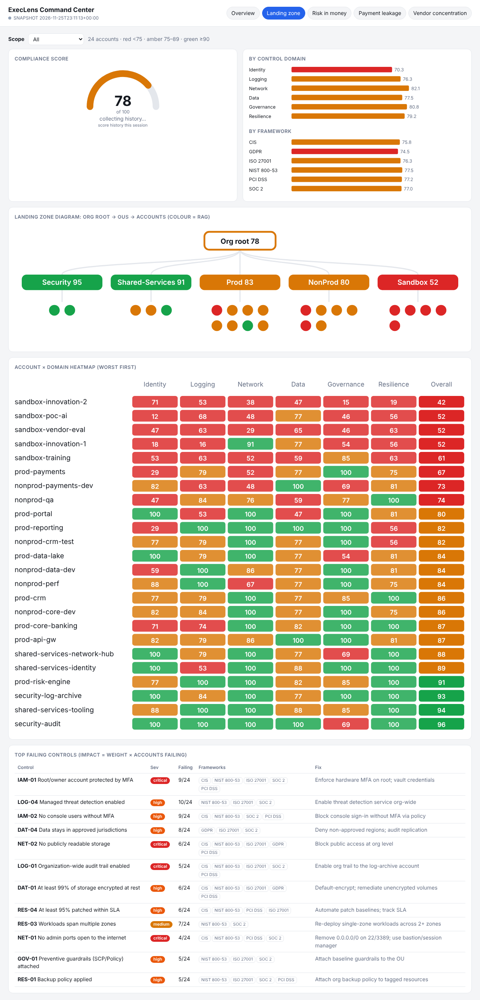
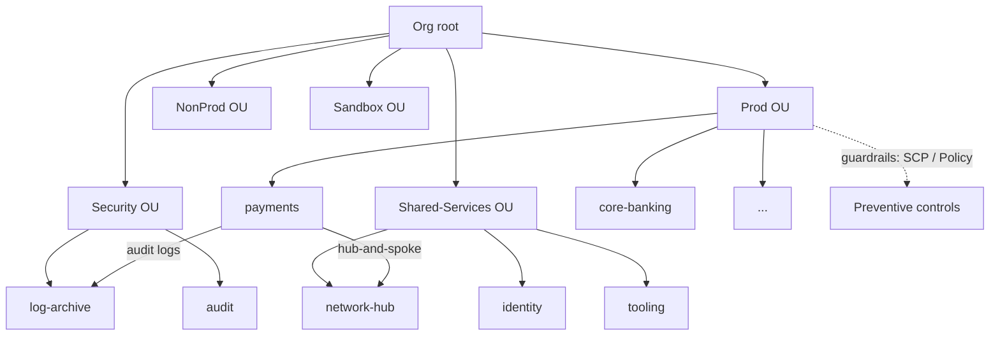
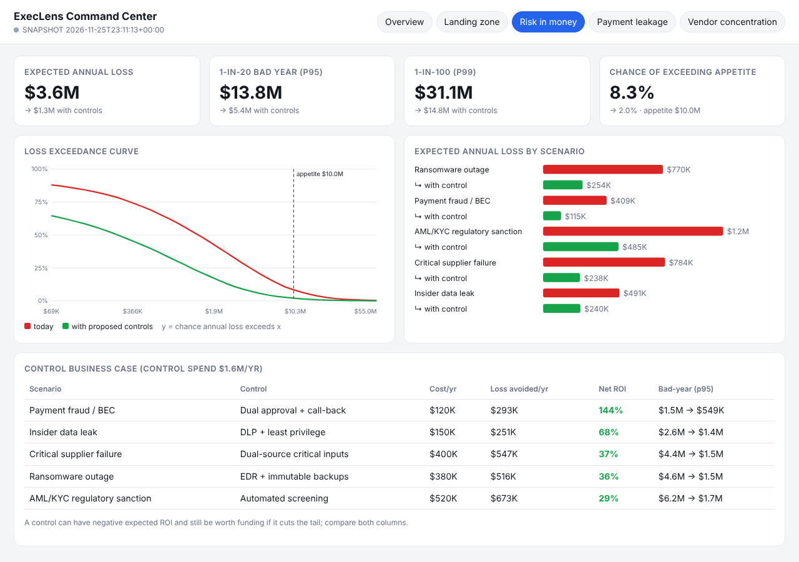
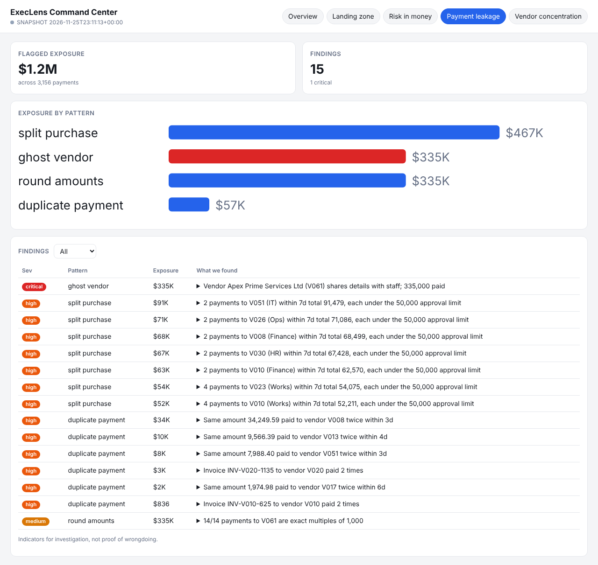

# ExecLens

**One live screen for the questions executives actually get asked by boards, regulators and auditors.**
Pure Python standard library: no dependencies, no cloud credentials, no data leaves the machine, so it runs
inside locked-down bank, government and parastatal environments.

| Question | Module | Output |
|---|---|---|
| Is our cloud landing zone actually compliant, and where is it weakest? | `landingzone` | Scorecard by account, OU, domain and framework (CIS, NIST 800-53, ISO 27001, SOC 2, PCI DSS, GDPR) |
| How much could we lose, and which control spend pays back? | `riskquant` | Monte Carlo loss exceedance curve, p95/p99, chance of breaching risk appetite, control ROI |
| Where is money leaking? | `forensics` | Duplicate payments, split purchases under approval limits, ghost vendors, round-amount and Benford anomalies |
| Which suppliers can sink us? | `concentration` | HHI, top-N share, critical + sole-source single points of failure |



## Run it (60 seconds)

```bash
pip install .                      # or: python -m pip install -e .
execlens demo --out out            # writes out/dashboard.html (open in any browser) + sample inputs
execlens serve --simulate          # LIVE dashboard at http://127.0.0.1:8080, estate drifts every 4s
python -m unittest discover -s tests -v
```

Or with Docker: `docker build -t execlens . && docker run -p 8080:8080 execlens`

Try the CLI against the sample inputs in `examples/`:

```bash
execlens lz    --inventory examples/landing_zone_inventory.json --fail-under 70   # exit 1 below 70: a pipeline gate
execlens risk  examples/risk_scenarios.json --appetite 10000000
execlens audit --payments examples/payments.csv --vendors examples/vendors.csv --employees examples/employees.csv
```

## Architecture



## Landing zone compliance scorecard



The scorecard evaluates each account/subscription against 30 weighted controls in six domains and rolls the
result up so a CISO sees the estate, and an engineer sees the fix.



How the score works:

* Each control has a weight (5 critical, 4 high, 3 medium, 2 low). Account score = weighted share of passing controls.
* Green is 90 or above, amber 75 to 89, red below 75. Domain and OU scores are averages of account scores.
* Framework score = weighted pass rate over only the controls tagged to that framework.
* The dashboard recalculates per OU when you change the scope, and keeps a live score history in `serve` mode.
* The sample estate plants one bad crown-jewel account (`prod-payments`: no root MFA, open admin ports, public bucket) so the story is visible.

## Risk in money



Each scenario has an annual frequency (triangular low/mode/high) and a per-event loss (lognormal fitted to a 90%
interval). Controls reduce frequency and/or impact. Baseline and controlled runs share random draws, so the
benefit estimate is paired and low-noise. The dashboard shows expected loss, 1-in-20 and 1-in-100 years, and the
chance of breaching a stated risk appetite, before and after controls.

## Payment leakage



Detectors: duplicate payments (same invoice, or same vendor and amount within 14 days), split purchases (same
vendor, department and approver, several sub-threshold payments within 7 days that together exceed the approval
limit), ghost vendors (bank account or address matching an employee), round-amount concentration, and Benford
first-digit tests (portfolio at p<0.05, per-vendor at p<0.001 to limit false alarms).

## Use it on real data

| Input | Format |
|---|---|
| Landing zone | JSON, see [docs/collectors.md](docs/collectors.md) for every key and where it comes from on AWS and Azure |
| Payments | CSV: `id,vendor_id,amount,date,invoice_no,department,approver` |
| Vendors | CSV: `id,name,category,bank_account,address,critical,sole_source` |
| Employees | CSV: `id,bank_account,address` |
| Risk scenarios | JSON, see `examples/risk_scenarios.json` |

## Honest limits

* The sample data is synthetic. Numbers in the screenshots are illustrative, not benchmarks.
* Risk inputs are estimates; garbage in, garbage out. Use calibrated ranges from your own loss data and experts.
* Forensic findings are indicators for investigation, not proof of wrongdoing. Expect false positives; tune thresholds.
* Landing zone checks read an exported snapshot. Collectors are yours to run (and are not included, by design: no credentials in this tool).
* `serve` has no authentication or TLS. Run it on localhost or behind your own reverse proxy and SSO.

## Roadmap

Collectors for AWS and Azure inventories, custom control packs per regulator, trend storage, PDF board pack export, SSO-aware serving.

MIT licensed.
